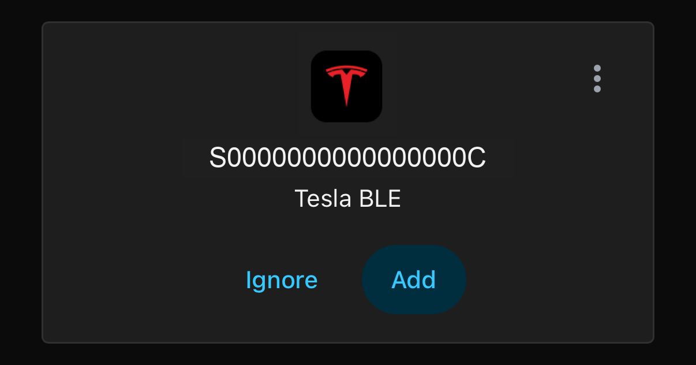
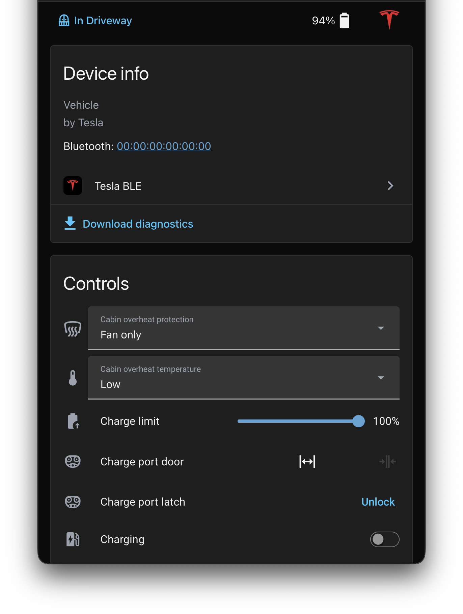

# Tesla BLE for Home Assistant

[](https://www.hacs.xyz/docs/faq/custom_repositories/)

Monitor and control your Tesla over Bluetooth—no Tesla cloud account, API token,
or subscription. Use your Home Assistant host's Bluetooth adapter or a stock
[ESPHome Bluetooth proxy](https://esphome.io/components/bluetooth_proxy.html)
near the car. No custom ESPHome vehicle component is required.

## What you get

- **Vehicle data:** battery, range, charging, temperatures, tire pressures,
  odometer, doors, locks, sleep state, estimated AC Energy, and battery Energy added.
- **Controls:** locks, charging, charge limit/current, climate, fitted seat
  heating/cooling, trunk/frunk, charge port, windows, lights, and horn.
- **Bluetooth presence:** know when the car is nearby—not GPS tracking.
- **Auto-discovery:** nearby cars appear in HA, ready to add and pair.
- **Sleep-friendly polling:** automatic updates do not deliberately wake the car.

Optional controls appear after the vehicle reports support. Not every vehicle
supports every feature.

## Requirements

- **Home Assistant 2026.3.0+**, preferably the latest patch release.
- A working **Bluetooth** integration, using a local adapter or an ESPHome
  proxy with **active connections** enabled.
- A BLE-capable Tesla within range and a **key card** for pairing.
  Legacy Model S/X (pre-2021) are not supported.
- **x86-64 or ARM64** Linux (glibc/musl) or macOS. Windows and 32-bit ARM
  native wheels are not provided.
- Internet access to download dependencies during installation; vehicle
  communication stays local.

Tested with **HA 2026.10**. The minimum is based on the [Python 3.14 upgrade](https://www.home-assistant.io/blog/2026/03/04/release-20263/#running-on-python-314-)
and API review, not runtime testing on 2026.3.

## Installation

### HACS

Add this integration as a **custom repository**. HACS requires a public GitHub
repository; use manual installation if you only have private repository access.

[](https://my.home-assistant.io/redirect/hacs_repository/?owner=yoziru&repository=ha-tesla-ble&category=integration)

1. In HACS, open **⋮ → Custom repositories**.
2. Add `https://github.com/yoziru/ha-tesla-ble`, category **Integration**.
3. Download **Tesla BLE**, then restart Home Assistant.
4. Follow **Setup and pairing** below.

### Manual installation

1. Download a release or source archive using your repository access.
2. Copy its `custom_components/tesla_ble` folder to
   `<config>/custom_components/tesla_ble` in Home Assistant.
3. Restart Home Assistant, then follow setup below.

Home Assistant installs the native `tesla-ble` dependency automatically from
PyPI. On supported platforms, no compilation is needed.

## Setup and pairing

[](https://my.home-assistant.io/redirect/config_flow_start?domain=tesla_ble)

Nearby cars are **automatically discovered** under **Settings → Devices & Services**.



1. Click **Add** on the discovered Tesla BLE card, or choose
   **Add Integration → Tesla BLE** manually.
2. Select the car and enter its **VIN**. If it is not discovered,
   enter its Bluetooth address manually; find it in Bluetooth's
   **Advertisement monitor**.
3. When prompted, tap a **key card on the car's center-console reader**.
   Pairing progress and results appear in Home Assistant notifications.

If pairing fails, enable **Pair vehicle** on the device's entity page and press
it to retry. Add the integration separately for each vehicle.

## Daily use

Open the Tesla BLE device page to find its sensors and controls.



| Task | Entity or setting |
| --- | --- |
| Fetch fresh data, waking the car if needed | **Force refresh vehicle data** |
| Wake a sleeping car | **Wake up** |
| Pause automatic updates | **Polling** switch |
| Change polling intervals | Integration **Options** |
| Change the Bluetooth address without losing keys | **Reconfigure** |
| Check whether the car is nearby | **Location** or **Connection** |
| Check a command's result | **Last command** |

### Sleep and availability

Automatic polling does not send wake commands. **Force refresh vehicle data**
and explicit controls can wake the car. A sleeping car may show **cached data**, not current
measurements. When it leaves Bluetooth range, telemetry becomes unavailable
after about two minutes; **Location** changes to `not_home`.

Defaults: vehicle status every **60 seconds**, awake data every **30 seconds**,
charging/sentry data every **10 seconds**, and idle/asleep data every
**660 seconds**. Idle disconnect defaults to **120 seconds**. Bluetooth activity
can still affect sleep and battery use.

Use the **Polling** switch to pause updates—not HA's generic **Enable polling
for changes** option. Force refresh and controls still work while paused.

### Useful limitations

- Seat controls require climate/preconditioning or Climate Keeper to be on;
  selecting seat heat/cooling does not turn climate on.
- **Power** is the car's own AC measurement (volts × amps × phases; the reported
  power is an attribute). **Energy** integrates that AC power, **Energy added** is
  the battery-side session total. Neither is a lifetime meter; AC energy is an
  estimate and differs from battery-side energy by charging losses (~5–15%).
- **Firmware** shows offered updates and their progress. The installed version
  is **Unknown** because BLE does not report it. The
  `tesla_ble.cancel_software_update` action can cancel a schedule/download,
  not an installation already running.
- Some diagnostic and pairing entities are disabled by default. Enable them
  on the device's entity page when needed.

### Keys and removal

Keys survive restarts and updates. They are stored locally in owner-only files,
not encrypted at rest. Restrict access to HA's configuration directory, use
encrypted backups, and keep the backup recovery key separate from backup copies.

**Regenerate key** replaces the local key and requires pairing again. Deleting
the integration removes its local keys and Energy counter. Neither operation
revokes the old key in the car; remove it from the vehicle's key list yourself.

## Troubleshooting

| Problem | What to check |
| --- | --- |
| Car not discovered | Bluetooth Advertisement monitor, proxy range, active connections, and supported vehicle. Discovery requires about 30 seconds of advertising. |
| Pairing fails | Keep the car reachable, retry **Pair vehicle**, and tap the card when prompted. Check notifications and **Last command**. |
| Commands time out | Bluetooth range and free connection slots. Close competing phone/watch apps where practical; use **Wake up** to check recovery. |
| Sleeping car's data does not refresh | Automatic polling does not wake it. Use **Force refresh vehicle data** to wake and fetch fresh data. |
| Dependency installation fails | Check HA version, CPU/platform, internet access, and the package-install error in HA logs. |
| Energy total jumps | Older versions counted the car's downward session revisions as new energy. Update the integration; existing totals are not rewritten. |

For a stale BlueZ discovery entry, removing only the car's cached entry with
`bluetoothctl remove <car-mac>` can allow rediscovery on its next advertisement.

### Get help

Enable **debug logging** on the integration entry, reproduce the problem, then
disable it to download the log. Download diagnostics from the entry menu too.

[Open an issue](https://github.com/yoziru/ha-tesla-ble/issues) with your HA and
integration versions, host architecture, adapter/proxy setup, vehicle model/year,
and the failing action. Review attachments and redact VINs, Bluetooth addresses,
locations, and credentials. **Never upload `.storage` files or HA backups.**

## Development

Built on [TeslaBLE](https://github.com/yoziru/tesla-ble) and its native Python
bindings.

### Checks

```sh
uv sync --locked
uv run --no-sync ruff check custom_components tests scripts
uv run --no-sync ruff format --check custom_components tests scripts
uv run --no-sync mypy
uv run --no-sync pytest tests -q
uv run --no-sync python scripts/carcheck.py --help
git diff --check
```

Offline tests cover transport, commands/entities, recovery, pairing, credential
storage, and lifecycle behavior—not radio timing or physical vehicle controls.
Strict mypy covers transport, storage adapters, and constants.

Use [Conventional Commits](https://www.conventionalcommits.org/) for commit messages
and PR titles: `type(optional-scope): description`. Use `feat`, `fix`, `docs`,
`test`, `refactor`, `chore`, or `ci`; add a scope when useful, such as
`fix(ble): recover disconnected sessions`. Mark breaking changes with `!`.

### Releases

Run **Actions → Release → Run workflow** from `main`. Choose patch/minor/major,
or enter an explicit `X.Y.Z`. It updates the manifest through a PR, waits for
checks, squash-merges, then publishes the GitHub release with generated notes.

One-time setup: add a repository secret named `RELEASE_TOKEN` for this repository
(Contents and Pull requests: write; Actions and Checks: read).

### Standalone vehicle CLI

Without HA, use Python 3.13+ with Bluetooth on a supported native-wheel platform:

```sh
pip install tesla-ble bleak
python scripts/carcheck.py --vin <VIN> --scan
python scripts/carcheck.py --vin <VIN> --pair --timeout 60
python scripts/carcheck.py --vin <VIN> --poll --timeout 60
```

The CLI stores its own key in `~/.tesla-ble/carcheck-<VIN>.json`; pair HA
separately. Polling does not intentionally wake the car; use `--wake` when needed.
Failed or incomplete requests return a nonzero exit code.

For hardware testing, keep the car parked, have a key card ready, and observe
physical controls with sufficient clearance. Check pairing and full polling on
both a local adapter and a stock ESPHome proxy (release competing connections
first), then verify controls and HA state, range-loss recovery, reload during
pending operations, sleep/no-wake polling, and independent vehicles/keys.
Review logs and snapshots for private data before sharing; never publish keys.

## License

[AGPL-3.0-only](LICENSE).
